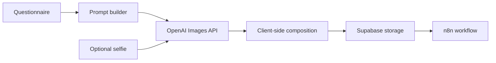

# AI Sticker Generator

An end-to-end image workflow that turns a short questionnaire and an optional selfie into a composed sticker. The product combines OpenAI image generation and edits, a React interface, Supabase storage and n8n automation.

[Live demo](https://sticker-generator-tan.vercel.app)

## Product flow



The UI guides the user through a small set of choices, builds a structured prompt, generates or edits the image, then composes the final artwork in the browser. Server endpoints keep provider credentials away from the client.

## Highlights

- Image generation and selfie-based edits with the OpenAI Images API.
- Multi-step React experience with progress, loading, error and result states.
- Client-side image composition and print preview.
- Supabase upload flow and n8n webhook handoff.
- Centralized server configuration and environment validation.
- Vitest coverage for API handlers, prompt utilities and submission services.
- GitHub Actions quality checks for linting, types, tests and build.

## Stack

React 19 · TypeScript · Vite · Express · OpenAI · Supabase · n8n · Vitest · Framer Motion

## Architecture

```text
api/                  Server endpoints and provider integrations
  services/           OpenAI, Supabase and configuration modules
src/
  components/         Questionnaire, capture, preview and result UI
  services/           Client API and workflow orchestration
  utils/              Prompt building and image composition
tests/                Backend, service, utility and component tests
```

## Run locally

```bash
npm install
cp .env.example .env
npm run dev
```

The server expects `OPENAI_API_KEY`, `SUPABASE_URL`, `SUPABASE_SERVICE_KEY` and `N8N_WEBHOOK_URL`. Keep provider and service-role credentials on the server. See the source configuration module for optional values.

## Quality commands

```bash
npm run lint
npm run typecheck
npm run test:ci
npm run build
```

## Security

- Provider keys and Supabase service-role credentials belong only in server environment variables.
- The browser talks to server endpoints rather than reading privileged credentials.
- Generated uploads should use a dedicated bucket with the narrowest access policy required by the product.

## Current status

The core generation, edit, composition, upload and webhook paths are implemented. The next product-level improvements are end-to-end browser coverage, generation telemetry and failure-rate monitoring.
